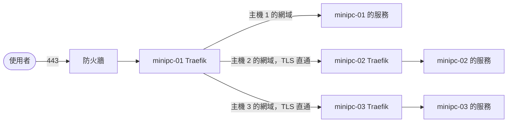

# 多主機 Traefik 入口

> 狀態：已上線（minipc-01、minipc-02、minipc-03 的 `~/traefik/`）。
> 何時讀：要調整共用入口的架構、憑證策略或接入規則時。要部署本服務讀 `services/traefik/README.md`；要把服務接上入口讀 `services/traefik/USAGE.md`（即說明頁內容）。

## 1. 目標

每台主機各跑**一個** Traefik，該主機上的 compose project 共用它當 HTTPS 入口，憑證自動簽發；想接入的人看說明頁就能自行接上。minipc-01 是唯一的外網入口；minipc-02、minipc-03 沒有 NAT，外網流量由 minipc-01 依網域轉入。

範圍限 HTTP 系協定的服務；一般 TCP、UDP 服務不經本入口，邊界讀 `services/traefik/USAGE.md`〈適用範圍〉。

🚫 不接手主機 nginx 的 80/443/8543/8090（遷移另案）、不影響既有容器。

## 2. 選案

| 決策 | 採用 | 未採 |
|---|---|---|
| 部署單位 | **獨立 project `traefik`**，各服務以外部網路接入 | 放在 vpn-router 內：其 `down` 會斷其他服務入口 |
| 多主機 | **每台獨立 Traefik**，同一份 compose，差異放各主機 `.env` | Swarm overlay 共用單一入口：服務要改 stack、需 registry，且 minipc-01 成單點；minipc-01 以 file provider 轉送：路由不能靠 label 自助接入 |
| 對外入口 | minipc-01 **8443/tcp**（路由器只轉送到這台）；minipc-02、minipc-03 **443/tcp**，不轉送 | minipc-01 用 80/443：主機 nginx 佔用 |
| HTTP 入口 | **`web` entrypoint（:80），主機 port 由 `TRAEFIK_HTTP_PORT` 設定，不跳轉 HTTPS**；留空時只綁 loopback，等同不開放 | minipc-01 開 80：主機 nginx 佔用；跳轉 HTTPS：HTTP 要能直接使用 |
| 內外網區隔 | **以 hostname 控制**：服務只寫內網名稱，不做來源或入口隔離；僅用於開發測試，安全與保密等級低，接受此風險 | 外網專用 entrypoint：防火牆與 DNS 都無法把內網 `fet` 流量分開；`ipAllowList` 放行公網 IP：DDNS 下要自動更新，維運成本高 |
| 根網域 | **兩組**：`TRAEFIK_BASE_DOMAIN`（對外）、`TRAEFIK_LAN_DOMAIN`（內網，DNS 指該主機 LAN IP），皆由 `.env` 設定；每個 router 同時列兩者。只支援內網的主機 `TRAEFIK_BASE_DOMAIN` 留空，router 只列內網網域 | 只用對外網域：路由器無 NAT loopback，LAN 內連不到 |
| 憑證 | **Let's Encrypt 萬用字元憑證**，一張涵蓋兩組根網域與其 `*.`，Cloudflare DNS-01；接入方只開 TLS，不另申請 | 各 router 各自申請：每個新網域都要等簽發、消耗頻率額度 |
| 說明頁 | **`https://traefik.<TRAEFIK_LAN_DOMAIN>:8443`，同時是內部來源的預設頁（根網域、主機 IP 與沒有對應路由的名稱都顯示它），來源只限私有網段與 NetBird**，渲染 `services/traefik/USAGE.md` | 對網際網路公開：內容含內部網段與 IP；另開 LAN 專用 HTTP port：多一個入口與 port；同時掛對外網域：白名單內的使用者都走不到（LAN 無 NAT loopback、遠端經當地網路出去），掛了也沒用 |

## 3. 接入契約

- **組成**：共用網路與網段、Traefik 固定 IP、entrypoint、certresolver、啟用 label、命名前綴；各項的值與寫法讀 `services/traefik/USAGE.md`（說明頁要讓接入者一頁看完，故值只寫在該處）。
- **設計理由**：固定 IP 供接入方設 trusted proxy；`exposedbydefault=false` 防止既有容器被誤路由；命名前綴因 router／service 名稱整台共用。
- **穩定性**：變更任一項即為破壞性變更，須同步所有接入方。

## 4. 設定

- **DNS**：對外根網域跟著 DDNS 指公網 IP；LAN 根網域各自直接指該主機 LAN IP，LAN 內不經路由器（無 NAT loopback）；皆不走 Cloudflare proxy，以免攔下非標準 port 與 gRPC。兩組都含 `*.`，接入方用根網域下一層的名稱即可，不必再設 DNS。具體記錄讀 `services/traefik/README.md`〈1. Cloudflare DNS〉。
- **只支援內網的主機**：`TRAEFIK_BASE_DOMAIN` 留空，憑證只簽內網網域與其 `*.`，說明頁不顯示外網示例。
- **TLS**：萬用字元只能用 DNS-01；DNS-01 只需 Cloudflare API 建 TXT，申請與續期不需對外開 80/443；生效檢查查公共 DNS，不受主機（含 ppp0）解析器影響。萬用字元憑證掛在 TLS default store（掛在 router 上無法正確簽出，traefik/traefik#12109），接入方 router 只設 `tls=true` 即以 SNI 取用；根網域外的名稱仍可用 certresolver `le` 單獨申請。
- **HTTP**：`tls=true` 的 router 只聽 TLS，走 HTTP 要另設 `entrypoints=web`、不設 tls 的 router，接入方自行決定是否提供。HTTP 為明文，只在沒有對外轉送的主機開放。
- **gRPC／長連線**：entrypoint 與後端逾時皆關閉，供 NetBird 等長連線服務使用。
- **預設頁**：說明頁 router 用 `HostRegexp` 全匹配加 `ClientIP`、優先序 -1，接入方即使設優先序 1 也優先；內部來源打錯名稱或接入方未啟動時會看到說明頁而非 404，查路由看 log。以 IP 連線時憑證不含 IP，瀏覽器會警告。
- **說明頁**：網域只擋得住解析，擋不住外網直接帶 Host 連 8443，故在規則內以 `ClientIP` 限來源為三段私有網段（涵蓋 LAN 與路由器 VPN）及 NetBird 的 100.64.0.0/10，各主機共用同一規則、不必依網段調整；其餘來源不匹配，名稱正確的接入路由照常、錯誤回 Traefik 預設 404；NetBird 遠端經已發布的 192.168.1.0/24 連入。內容即 `services/traefik/USAGE.md`，接入規則因此只維護一份；文件在 git 中以 `wan.example.com`／`lan.example.com` 與預設 443（網址不帶 port）為通用示例，建置說明頁時代入 `.env` 的實際根網域，port 非 443 時網址補上 `:<port>`。
- 要部署、查變數、port 或維運指令時讀 `services/traefik/README.md`。

### 跨主機轉送

每台主機有一組對外網域（DNS 都指向同一個公網 IP），流量全部進 minipc-01 的 Traefik，再依網域分流：

- **直通**：minipc-01 只看 SNI，不解 TLS；憑證由目標主機以 DNS-01 自簽，`TRAEFIK_BASE_DOMAIN` 填該主機的對外網域。
- **設定**：路由寫在 `configs.tls` 的 `tcp` 區段，由 file provider 載入，目標在 `.env` 的 `FORWARD_*`；未設定的主機使用不會命中的佔位名稱。改動要重建該主機 Traefik。
- **開放範圍**：由目標主機的服務 `rule` 是否列對外網域決定，依〈內外網區隔〉只靠 hostname。
- **來源 IP**：以 PROXY protocol v2 把真實來源帶到目標主機，目標主機 `TRAEFIK_PROXY_TRUSTED_IPS` 只信任 minipc-01，外網開不存在的名稱回 404。內網經防火牆 hairpin 時來源是公網 IP，同樣視為外部。
- **單點**：minipc-01 停機時外網路徑全斷，內網網域不受影響。
- **主機 1 的對外網域**：以 `TRAEFIK_EXTRA_DOMAIN` 加進 default store 的 SAN，與 `fet` 系列共用一張憑證；重建後到新憑證簽好前，約一兩分鐘會用 Traefik 預設憑證。

## 5. 上線、風險與回復

**上線驗收**：接入網域的憑證簽發者為 Let's Encrypt（驗證方式見 `services/traefik/USAGE.md`〈驗證憑證〉）；說明頁在 LAN 與 NetBird 遠端可開（已驗證：NetBird 遠端來源 IP 為 100.x，規則放行）；根網域、主機 IP 與不存在的名稱在內部來源顯示說明頁，在外網回 404；既有接入路由不受影響。minipc-02、minipc-03 憑證簽發者為 Let's Encrypt，內部來源經根網域、`traefik.`、不存在的名稱與主機 IP 都顯示說明頁（已驗證）；NetBird 遠端連入未驗證。

| 風險 | 後果與對策 |
|---|---|
| 接入方重名 | 該路由失效；依 §3 命名規則 |
| 本 project 停機 | 該主機所有接入方入口中斷，其他主機不受影響；`restart: unless-stopped`，維運前通知接入方 |
| 網路名稱或 IP 變動 | 接入方連不到或不信任代理標頭；依 §3 視為破壞性變更 |
| hostname 不是安全邊界 | Host、SNI 都由用戶端填寫，外網帶內網名稱就能連到未限來源的服務；環境僅供開發測試，已接受。要提高安全或保密等級時，改採來源限制或獨立入口 |
| Let's Encrypt 頻率限制 | 同網域約每週 5 次；測試先用 staging |
| Cloudflare token 分散多台 | token 範圍是整個 zone，任一台被入侵都能改所有 DNS 記錄；權限無法再縮，外洩時立即撤銷並重發 |

**回復**：`docker compose down`（保留 volume 即保留憑證）；接入方入口同時中斷。
